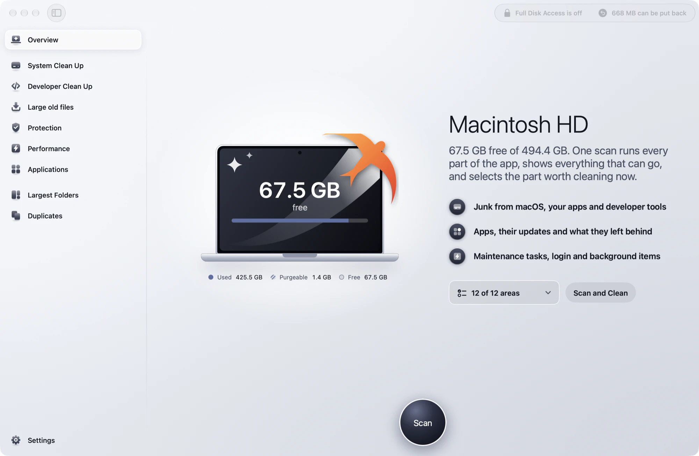
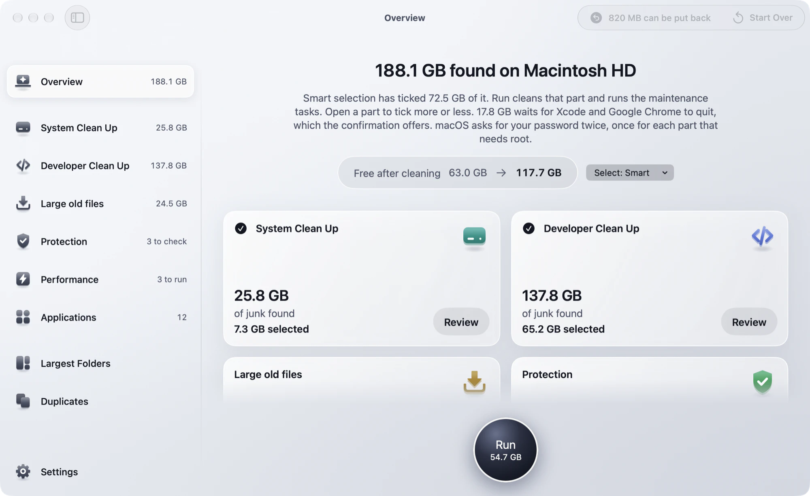
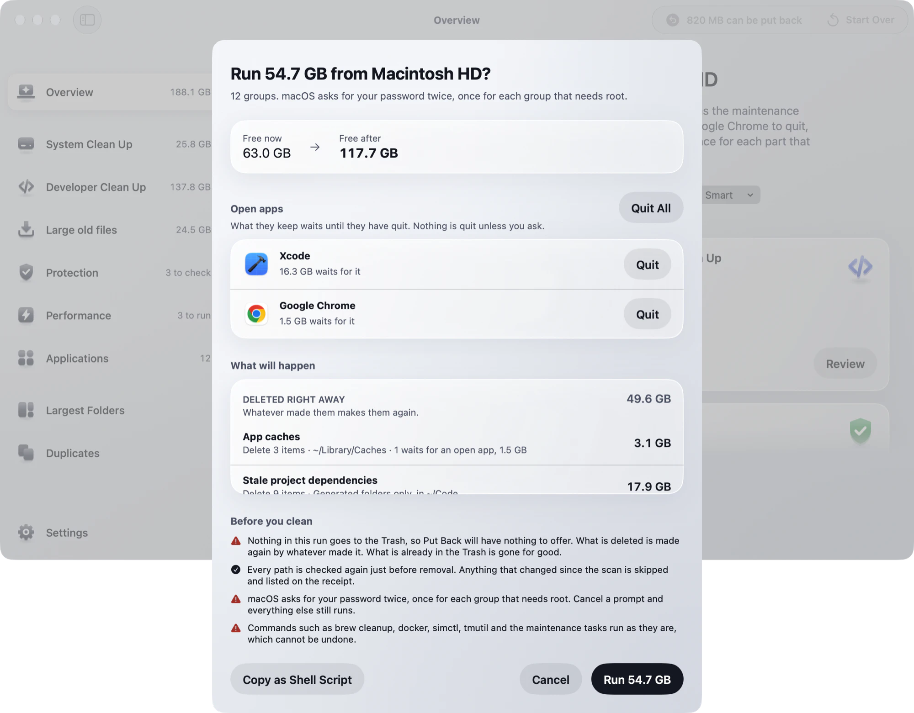
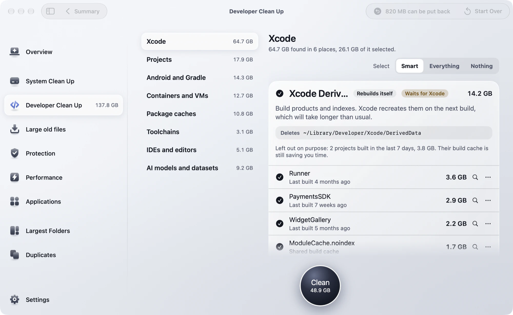
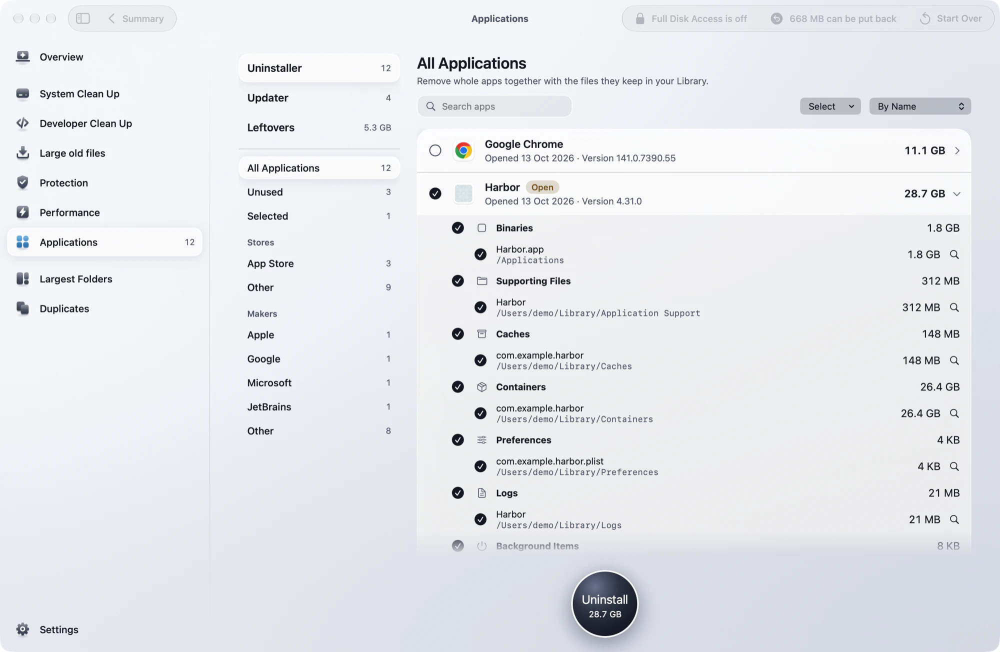
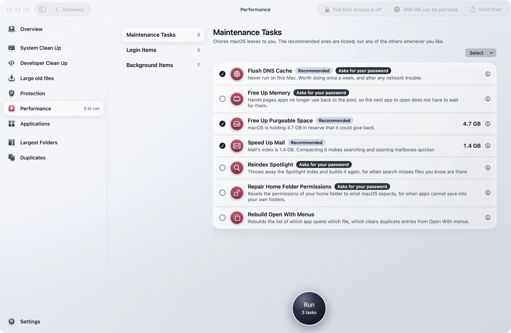
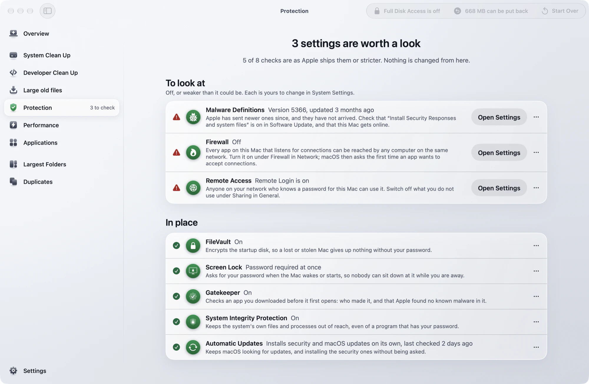
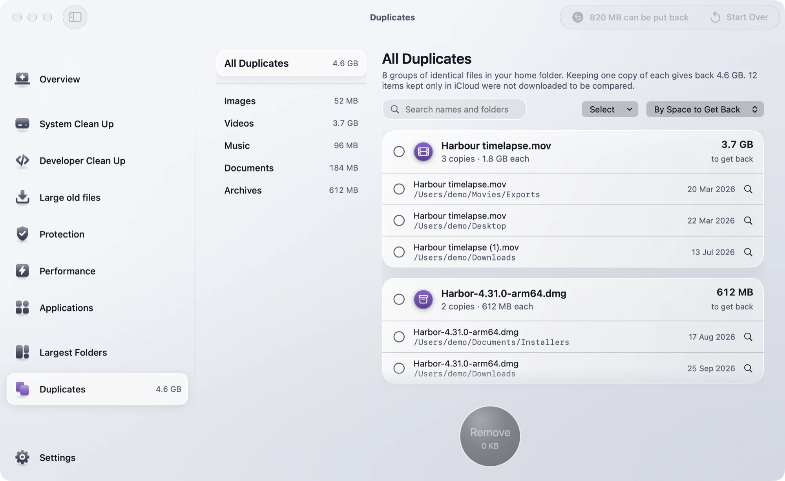
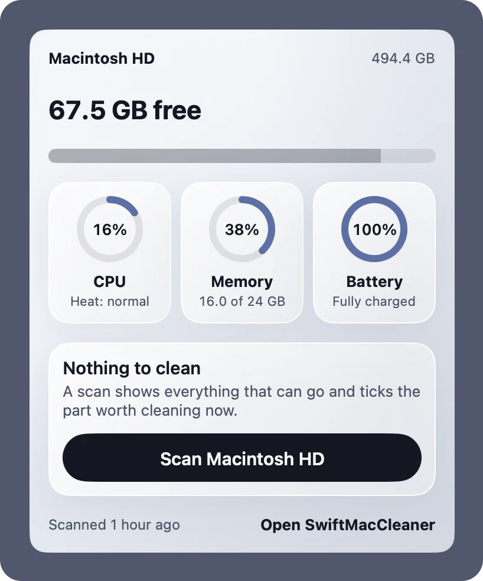

# SwiftMacCleaner

A disk cleaner and maintenance app for macOS, written in SwiftUI. It scans for what can go, shows
all of it, and removes only what you tick.

<p align="center">
  
</p>

> **This app deletes files and can run commands as root.** It comes with no warranty: see the
> [licence](LICENSE). Read the review sheet before you confirm a clean, and keep a backup.

## What it does

| Part | What it looks at |
| --- | --- |
| **Overview** | One scan that runs the clean-ups, Protection, Performance and Applications together, with a tile for each. |
| **System Clean Up** | Caches and logs, the Trash, Time Machine local snapshots and iPhone backups. |
| **Developer Clean Up** | Xcode, stale projects, Android and Gradle, containers and VMs, package caches, old toolchains, IDEs and editors, AI models and datasets. Only the areas this Mac has tools for are scanned. Source files are never touched. |
| **Large old files** | Big files in Downloads, Documents and Desktop that have sat untouched for months. |
| **Largest Folders** | Measures a folder tree and lets you walk down into it. |
| **Duplicates** | Identical files, keeping one copy of each. |
| **Applications** | Uninstalls an app together with its files, launch daemons and helpers; lists updates and installs the ones Homebrew has; clears leftovers of apps that are gone, and old installers. |
| **Performance** | Maintenance tasks, login items and background items. |
| **Protection** | A read-only check of FileVault, the screen lock, Gatekeeper, System Integrity Protection, malware definitions, automatic updates, the firewall and sharing. It changes nothing. |
| **My Activity** | What the app has done on this Mac: what it cleaned, part by part, what else it did, what is worth doing next, and every run in a History you can open, read the log of, and put back from. Counted from its own record; nothing is estimated. |
| **Menu bar** | Processor, memory and battery readings, and a check once a week. |

## A closer look

<table>
  <tr>
    <td width="50%" valign="top"><br><b>Overview after a scan.</b> A tile for each part, with what it found and what Smart selection ticked.</td>
    <td width="50%" valign="top"><br><b>Review before anything goes.</b> Every step and how it is carried out, and the open apps it waits for.</td>
  </tr>
  <tr>
    <td width="50%" valign="top"><br><b>Developer Clean Up.</b> Xcode, projects, package caches, toolchains and more, finding by finding.</td>
    <td width="50%" valign="top"><br><b>Applications.</b> An app and every file it keeps in the Library, removed together.</td>
  </tr>
  <tr>
    <td width="50%" valign="top"><br><b>Performance.</b> Maintenance tasks, login items and background items.</td>
    <td width="50%" valign="top"><br><b>Protection.</b> A read-only check of the Mac's own defences. It changes nothing.</td>
  </tr>
  <tr>
    <td width="50%" valign="top"><br><b>Duplicates.</b> Identical files, with one copy of each always kept.</td>
    <td width="50%" valign="top" align="center"><br><b>Menu bar.</b> Free space, processor, memory and battery.</td>
  </tr>
</table>

The pictures show the app's demo mode, so the findings in them are made up.

## How it keeps from removing the wrong thing

- **Nothing goes without a review.** Before a clean, a sheet lists every step and how it is carried
  out: deleted, moved to the Trash, handed to the tool that owns the data (`docker`, `xcrun simctl`,
  `brew`, `tmutil`), or done with your password. The same clean can be copied as a shell script to
  read first.
- **Smart selection ticks only what you allowed.** Settings has a switch for each kind of thing it
  may tick. Everything else a scan finds is shown unticked.
- **One guard stands in front of every removal.** `SafetyGuard` in
  [`Clean/Cleaner.swift`](SwiftMacCleaner/Clean/Cleaner.swift) passes a path only when it sits well
  inside the home folder or one of a few named folders, is on the same volume, is not in iCloud, is
  not part of a repository or a library macOS manages, and is not on the protected list: Mail,
  Messages, Photos, Notes, Keychains, `.ssh`, `.gnupg`, cloud storage and the like.
- **What an open app is using is left alone**, and so is anything on your Never Suggest list.
- **No helper runs as root in the background.** When root is needed, for old system logs, an app's
  files under `/Library` or some maintenance tasks, macOS shows its own password prompt for that
  one script.
- **Every clean is written down** in `~/Library/Logs/SwiftMacCleaner/`, and what went to the Trash
  can be put back. My Activity keeps its own record of each run beside the Put Back list, in
  `~/Library/Application Support/SwiftMacCleaner/activity.json`, on this Mac only.

## What it asks macOS for

- **Full Disk Access** is optional. Without it macOS keeps some folders private; the app scans the
  rest and says which ones it could not read.
- **Downloads, Documents and Desktop**, when a scan first looks there.
- **Automation** of System Events, to list login items, and of Finder, to move an app that macOS
  will not let it move itself.
- **Your password**, in macOS's own prompt, for the steps that need root.

The app is not sandboxed, since a sandboxed app could not reach what a cleaner cleans. The hardened
runtime is on.

## What it sends over the network

No analytics, and nothing about you or your files. The only requests are for app updates, and only
while "Look for app updates" is on in Settings:

- `itunes.apple.com`, with the identifiers of your App Store apps and your region;
- each app's own update feed: its Sparkle appcast, or the update file an Electron app names;
- `formulae.brew.sh`, for apps Homebrew installed.

Tools the app runs for you, such as `brew` and `docker`, make requests of their own.

## Building it

You need macOS 27 and Xcode 27. There are no dependencies to fetch.

1. Clone the repository and open `SwiftMacCleaner.xcodeproj`.
2. Run the `SwiftMacCleaner` scheme.

Out of the box the app is signed to run on the Mac that built it, which needs no Apple developer
account. macOS ties Full Disk Access to the signature, so an app signed that way may have to be
given access again after a build. To sign with your own team instead, see
[`Config/Signing.xcconfig`](Config/Signing.xcconfig).

To run the unit tests, press Command-U, or:

```sh
xcodebuild test -project SwiftMacCleaner.xcodeproj -scheme SwiftMacCleaner -destination 'platform=macOS'
```

The tests work in temporary folders, mostly on made-up tool output. They do not clean the Mac
they run on.

### Looking around without cleaning anything

A Debug build takes a few arguments:

```sh
SwiftMacCleaner.app/Contents/MacOS/SwiftMacCleaner --demo           # the app, with made-up findings
SwiftMacCleaner.app/Contents/MacOS/SwiftMacCleaner --print-scan     # prints what a real scan finds, and exits
```

`--print-apps`, `--print-space <folder>`, `--print-duplicates <folder>`, `--print-performance`,
`--print-protection` and `--print-vitals` print and exit in the same way. Two more are not
read-only: `--quick-clean` really cleans, and `--uninstall <app>` really moves that app to the
Trash. None of these exist in a Release build.

## Where things are

| Folder | What is in it |
| --- | --- |
| `SwiftMacCleaner/Scan` | The scanners, one for each area, and the catalogue of known tools. |
| `SwiftMacCleaner/Clean` | Plans, the safety guard, and the code that removes. |
| `SwiftMacCleaner/Model` | The state behind each part of the app, and the settings. |
| `SwiftMacCleaner/Views`, `Design` | The screens, and the drawing they share. |
| `SwiftMacCleaner/Vitals` | The processor, memory and battery readings. |
| `SwiftMacCleaner/Support` | Shell, files, formatting, and the made-up data for `--demo`. |
| `SwiftMacCleanerTests` | The unit tests. |
| `Screenshots` | The pictures in this README. |
| `Tools/make-glyphs.swift` | Draws the app's icons and writes them into the asset catalogue. |

## Contributing and security

See [CONTRIBUTING.md](CONTRIBUTING.md). To report something that could make the app remove the
wrong thing, or misuse the password it is given, see [SECURITY.md](SECURITY.md).

## Licence

[MIT](LICENSE).
